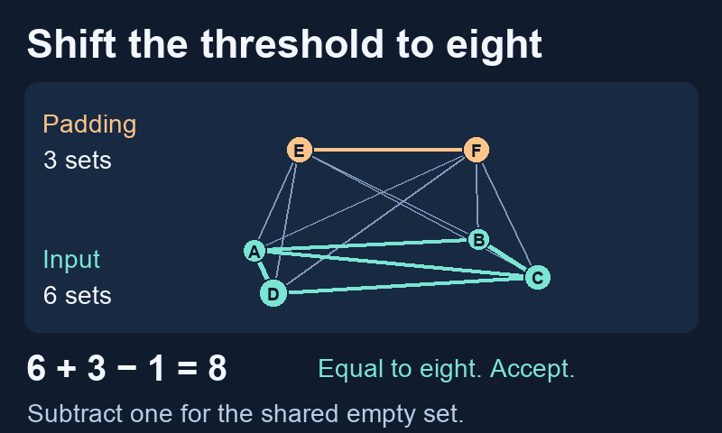

# Majority-SAT for 3-CNFs with One Unrestricted Clause

   

Testing whether a 3-CNF conjoined with one unrestricted clause satisfies at least half of the uniform assignments is PP-complete under polynomial-time many-one reductions. The proof also establishes PP-completeness for comparing a 2-CNF's satisfaction probability to an input power-of-two threshold. These are Akmal's Open Problems 8 and 9.

[Read the paper](paper/manuscript.pdf) · [LaTeX source](paper/manuscript.tex) · [Akmal’s Open Problems 8 and 9](https://www.shyanakmal.com/publications/ShyanAkmal_PhD-Thesis.pdf#page=94) · [Catalog Q75](https://github.com/10m-u/open-problems-catalog/blob/ca8d4d44ba3db527f19f28928c240168f545ecfe/problems/computer_science_ai/theory-of-computation-algorithms-part-1.md#q75) · [Archived release](https://doi.org/10.5281/zenodo.24569554)

## Explore the proof in 3D

Start with a square and one diagonal. The input has six independent sets, meeting its threshold. The padding edge has three independent sets. After joining the two graphs, every independent set lies on one side. The empty set belongs to both, so the joined count is 6 + 3 − 1 = 8. The selector makes the final satisfaction probability exactly one half. Toggle either diagonal in the explorer to move below or above the threshold.

[Download the offline explorer](https://raw.githubusercontent.com/DannyExperiments/majority-3cnf-one-long-clause/v1.0.0/visualization/majority-threshold-explorer.zip) · [Explorer source](visualization/index.html) · [GIF rendering source](visualization/render.py)

## Why the proof works

Given an integer threshold, build a small padding graph whose count shifts that threshold to a power of two. Encode the joined graph as a 2-CNF and add forced variables to turn the power-of-two count threshold into a dyadic probability threshold. Akmal’s selector adds a common literal to each clause and supplies the single unrestricted clause. The comparison with one half preserves the original inclusive tie.

The paper includes a direct reduction to the general-graph count threshold. The [literature review](audits/public_safe_reports/LITERATURE.md) explains the overlap with Cozman and Mauá, Finster et al., and Chan and Pak.

## Reproduce the checks

    python3 -I scripts/verify_repository.py
    python3 -I verification/src/replay.py

The [recorded exact checks](verification/results/replay.txt) cover the prescribed-count graph, twin replacement, integer threshold arithmetic and the three worked cases. The manuscript proves the general result. See [reproducibility](REPRODUCIBILITY.md), [scope](CLAIM_SCOPE_AND_LIMITATIONS.md) and the [research disclosure](AI_DISCLOSURE.md).

## Cite

DannyExperiments. *Majority-SAT for 3-CNFs with One Unrestricted Clause*. Version 1.0.0, 27 November 2026. [Version DOI](https://doi.org/10.5281/zenodo.24569554).
